# Atonacht

Daily notes and to-dos kept as plain Markdown files, on your own devices. One Tauri 2 + React codebase for desktop
(Windows, macOS, Linux) and Android. Syncthing does the syncing, so there is no server and your notes are never locked in.

## Screenshots

**Phone, Glass theme** — Home, All tasks, a task mid-swipe, the board, the calendar, notes, the editor, Syncthing setup:

<p>
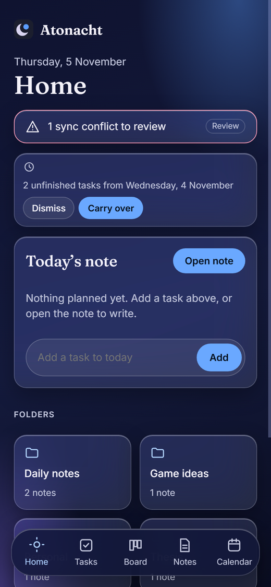
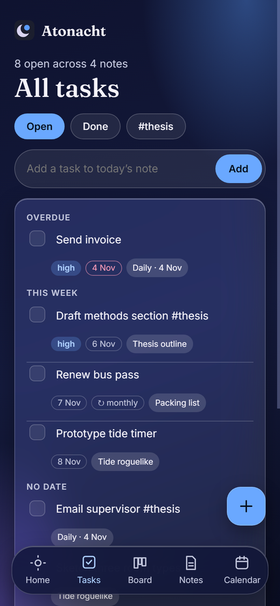
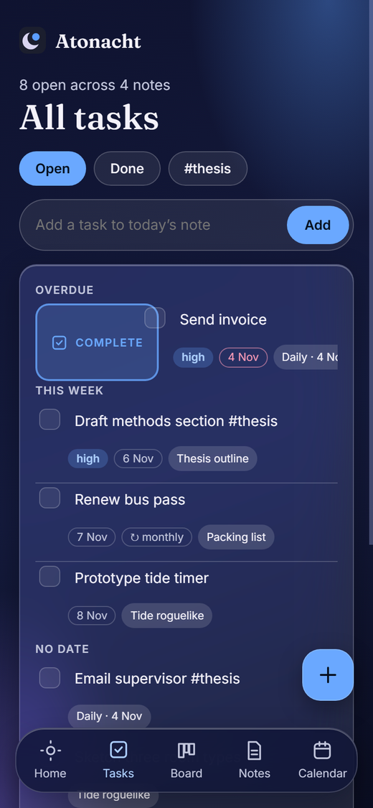
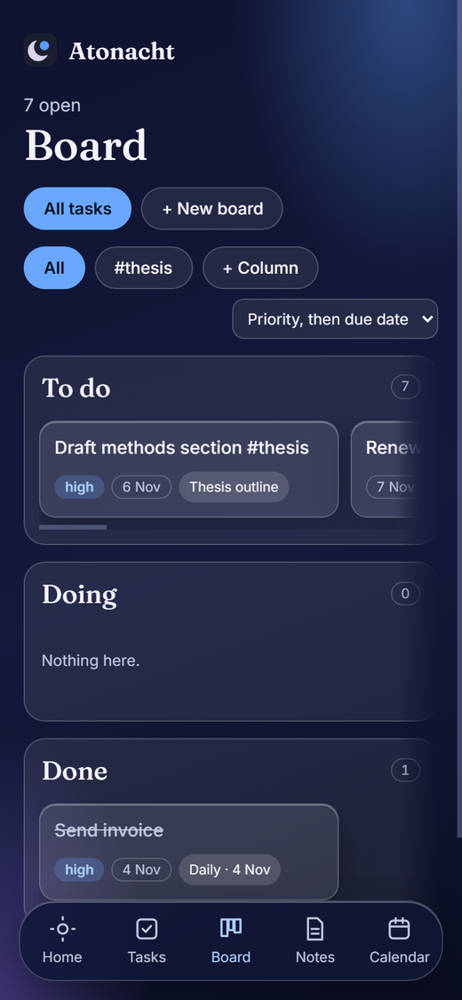
</p>
<p>
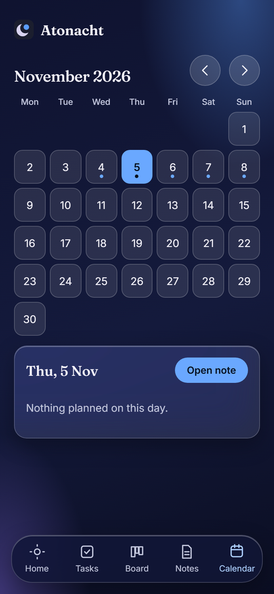
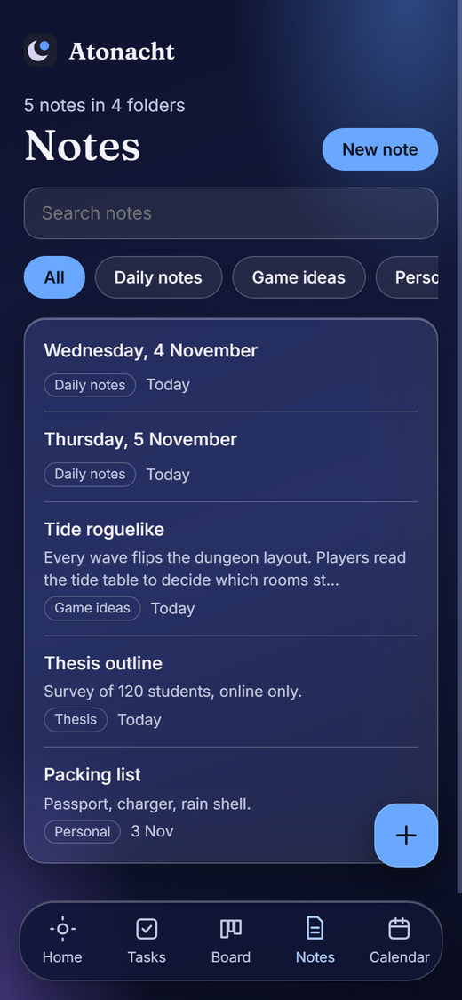

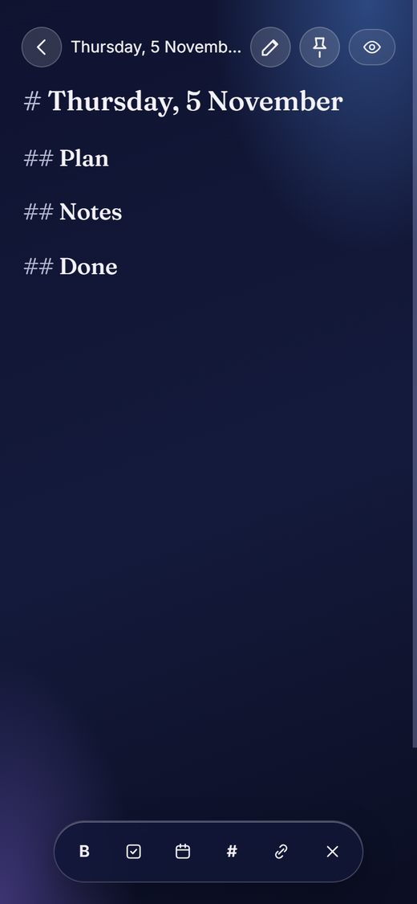
</p>

**Light theme, and the desktop layout** with its right-click menu:

<p>
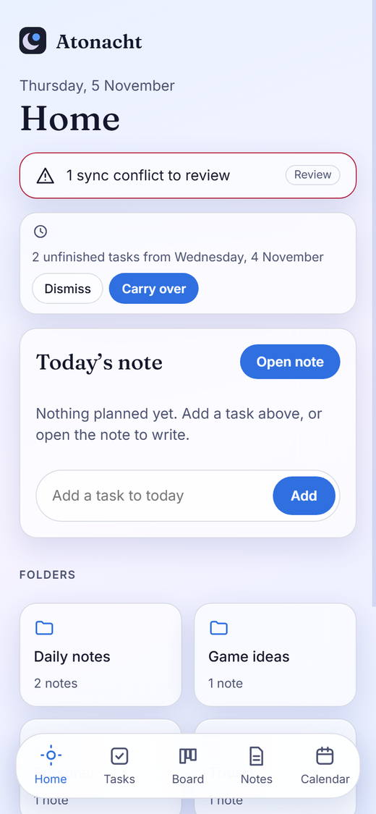
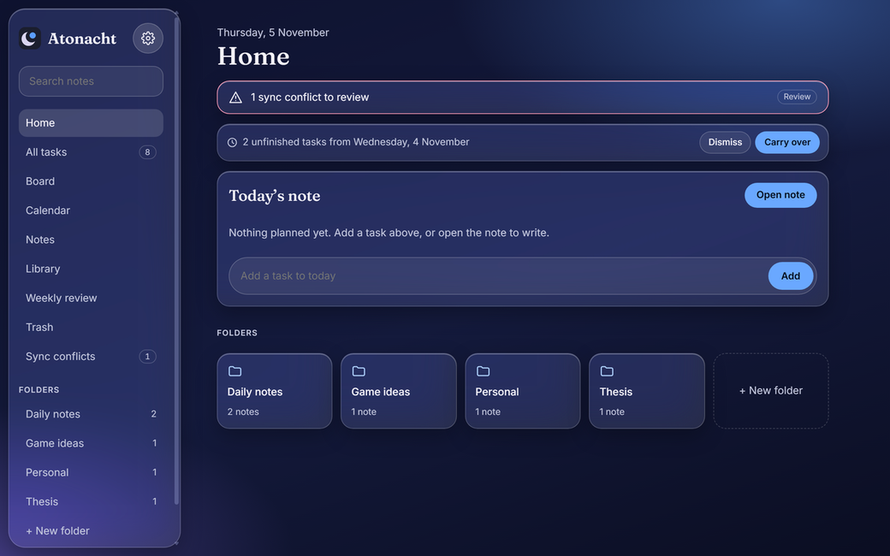
<br>
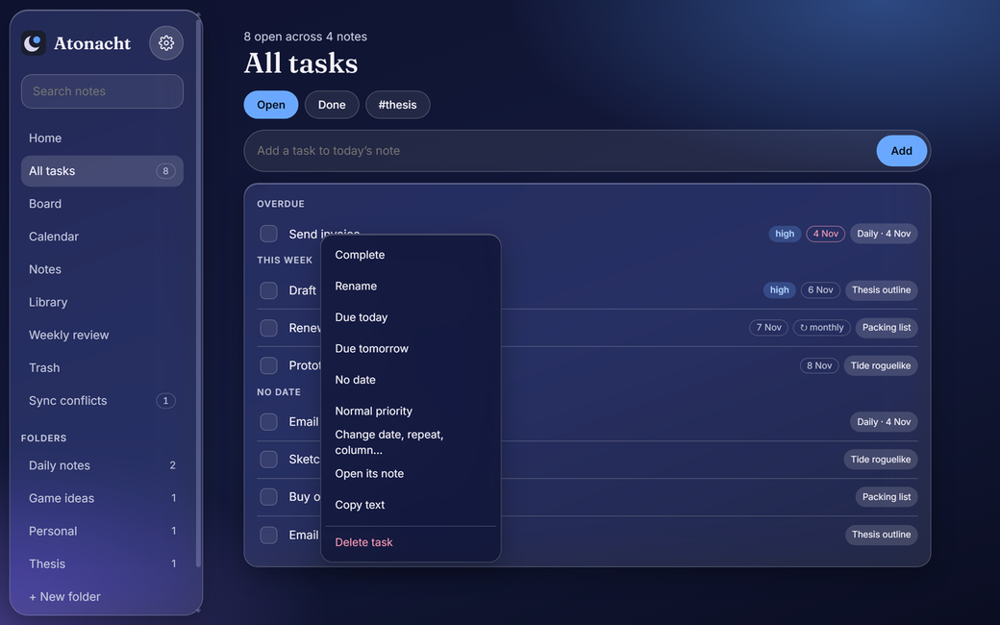
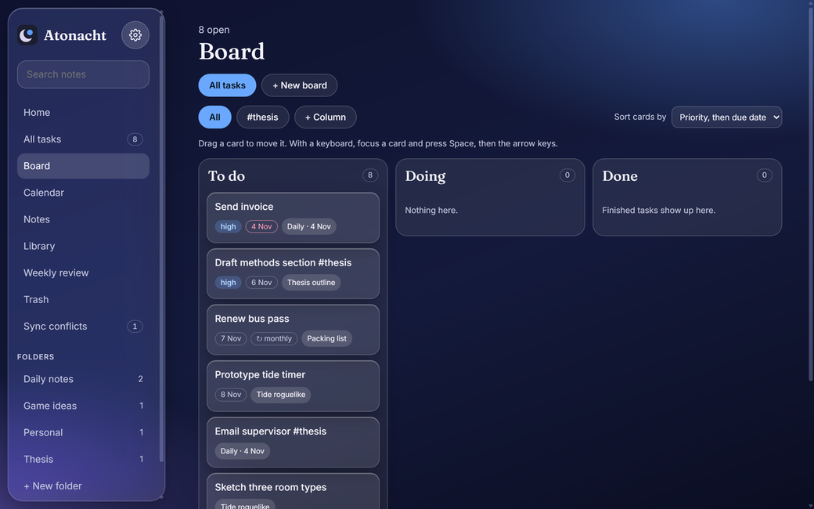
</p>

## Features

**Notes** — the raw Markdown stays on screen on every line (`##`, `- [ ]`, `@due(…)`), with headings sized and
`@due` / `!high` / `#tag` / `[[links]]` styled in place. Click a task's `- [ ]` to tick it off; Enter continues lists. The
eye button opens the preview, where **double-clicking a line edits just that line** (Enter writes it back, Shift+Enter
adds a line, Esc cancels). Folders, search, pinned notes (`pinned: true` front matter, so it syncs), rename/move,
templates in `Templates/` (`{{title}}`, `{{date}}`, `{{long_date}}`), and a Trash that empties itself after 7, 30 or 90
days — the deletion time lives in the file name, so it survives syncing.

**Attachments** — paste a picture into a note, or use the paperclip: the bytes go into `Attachments/` and a link is
written at the cursor. The preview reads them back through the folder, so it works the same on the desktop (Rust), on
Android (SAF) and in the browser demo. Pictures outside the folder are left as ordinary Markdown images.

**Links and tags** — every note shows what it links to and what points at it; a `[[link]]` to a name no note has is shown
as missing rather than dropped. Tags have their own screen with counts, and search understands `tag:`, `in:`, `due:`,
`is:` and `has:`.

**Tasks** live in the note text. Every checkbox in every note appears in All tasks, grouped Overdue / Today / This week /
Later / No date, and checking one writes back to its source note. Repeats: `daily`, `weekdays`, `weekly`, `weekly:thu`,
`monthly`, `monthly:29`, `yearly`, counted from the due date or the completion date. Home shows today's note with quick
add, carry-over of yesterday's leftovers, due today and pinned notes. **Tap a task to rename it in place; hold it for due
date, priority, repeat and board column.** On a phone, swipe right to complete and left to move to tomorrow or delete —
with a live panel while dragging and Undo after a delete.

**Board** — To do, Doing, Done plus any columns you add; a card's column is stored as `@status(doing)` in its line, and a
checked task is in Done (a repeating task dropped there starts its next round in To do). Sort by priority, due date, note
order or A–Z. Project boards are separate notes in `Boards/`, in Obsidian's Kanban format (`kanban-plugin: basic`,
columns as `##`, cards as list items), so the same file opens in both apps and dragging reorders the file. Drag with
mouse, pen, touch-hold or keyboard (Space, arrows, Space, Esc). On a phone the columns stack down the page and each
column's cards scroll sideways.

**Calendar** — the tasks written in a day's note, plus everything due that day. **Weekly review** — finished tasks, then
move each open one to next week, someday or drop; saves a summary note in `Weekly reviews/`.

**Sync** — share the notes folder with Syncthing (Syncthing-Fork on Android). Atonacht reloads as files arrive, detects
`*.sync-conflict-*` copies, shows a diff, and resolves with Keep this device / Keep other / Keep both; nothing is deleted
without going to `.trash`. Settings → Sync walks through the setup in three steps and can read Syncthing's own status
(connected devices, folder progress) with an API key.

**Reminders** — due-date reminders at a time you choose, plus a daily-plan and weekly-review nudge. A task can name its
own time with `@at(18:30)`, and quiet hours (22:00–07:00 by default) move anything that would land inside them to the
morning instead of dropping it. On Android they are
handed to the system, so they fire with the app closed; on desktop they fire while it runs.

**On Android** — system folder picker (no "all files" permission), a Today widget and a quick-add widget, "Add to
Atonacht" in the share sheet, app lock (fingerprint, face or screen lock), hide in recents, block screenshots, full screen
with the status and navigation bars hidden, and the back gesture: it closes what is open, steps back a screen, returns to
Home, then leaves the app. Widgets cannot tick tasks off — tapping one opens the app.

**GitHub as a second remote** — repository, branch and a fine-grained token in Settings → Sync. Sync fetches, reconciles
and commits (one commit per sync, not one per note) and runs on start and every ten minutes when GitHub is the chosen
remote; when both sides changed the same note the remote copy is kept beside yours. A note's commits are on their own
screen, with the old text and a Restore button.

**Elsewhere** — Diagnostics (version, folder, last error, copy for a bug report), command palette (Ctrl/Cmd + K), ZIP backup and restore (existing notes are never overwritten), and About
with the version, the licence list, an update check against GitHub releases and a pre-filled "Report a problem" issue.

## Note format

Plain Markdown; a task is a checkbox line with optional plain-text metadata:

```
- [ ] Draft methods section @due(2026-10-30) !high #thesis [[Thesis outline]]
- [ ] Renew bus pass @due(2026-11-01) @repeat(monthly)
- [ ] Draft methods section @status(doing)
- [x] Pay rent @done(2026-10-29)
- [>] Moved to another day (written by carry-over)
- [-] Dropped in the weekly review
```

Daily notes are `Daily notes/YYYY-MM-DD.md` (folder configurable). Paths starting with `.` (`.trash`, `.stfolder`,
`.stversions`) are ignored.

## Build and run

```bash
npm install
npm test                  # 148 unit and UI tests
npm run dev               # browser demo with sample notes: no real files, no notifications
npm run tauri dev         # desktop app
npm run tauri build       # desktop installers
```

Desktop needs Rust ≥ 1.77 and the [Tauri prerequisites](https://v2.tauri.app/start/prerequisites/).

```bash
npm run android:setup     # tauri android init, then widget, share receiver, permissions, manifest and boot theme
npm run tauri android dev
npx tauri android build --apk -t aarch64     # then: bash scripts/sign-release.sh
```

First run asks for the notes folder (default `~/Documents/Atonacht`); share that folder in Syncthing. On Android, allow
notifications when asked (and "Alarms & reminders" if they arrive late), add the widgets from the launcher, and share any
text to "Add to Atonacht". The widget list refreshes whenever the app is open.

## Performance

Measured in a build sandbox, not on a phone:

- 72 KB of compressed JavaScript on first load; the editor, settings, weekly review and ZIP code load on first use.
- Saving a note in a 5,000-note folder costs about 30 ms afterwards, because only the changed note is parsed again.
- Task lists and large folders draw 100 rows at a time with "Show more"; styling a 20,000-line note costs about 5 ms per
  keystroke, since only visible lines are decorated.
- A startup cache keeps the notes in IndexedDB so a launch shows them at once and re-reads only what changed. It never
  syncs and can be turned off or cleared in Settings → Files & backup.

## Layout

```
src/lib/        pure logic (tasks, repeats, daily notes, carry-over, conflicts, diff, markdown, reminders, weekly)
src/lib/        file layers: tauriFs (desktop), safFs (Android folder picker), memFs (browser demo)
src/store.tsx   loads all notes, polls for changes, writes through the file layer
src/ui/         screens, live editor (live.ts + LiveEditor.tsx), settings
src-tauri/src/notes_fs.rs   desktop file layer (path safety, atomic saves, trash, watcher filter), unit tested
android/ scripts/           widget, share receiver, manifest, boot theme; .github/ CI and release builds
```

## What is verified

- `tsc --noEmit`, the production web build, and **148 JavaScript tests**: task parsing, repeats, carry-over, conflicts
  and diff, pins, templates, week maths, reminders, editor decorations, per-line preview editing, calendar day tasks,
  update checking, torn and concurrent saves, folder counts, startup-cache retry, paged notes, the Android folder layer
  against a fake document provider, tab swipes, the back gesture, swipe-to-delete with undo.
- `cargo test`: **12 Rust tests** for the desktop file layer.
- CI is green: types, tests and web build; the Rust shell; desktop installers on Linux, Windows and macOS; an Android APK
  built and signed from the release keystore.
- The Windows build has been launched and renders; the main screens were reviewed in Chromium at 390×844 and 1280×800 in
  all three themes.

**Not verified:** Android on a physical device (the system folder picker with real document providers, widgets, share
sheet, scheduled notifications, screenshot and recents options), the fingerprint plugin, Syncthing status against a live
Syncthing, and macOS/Linux runtime.

## Known gaps

- Android cannot swap a finished file into place, so a save briefly empties the note before writing it; Atonacht reads it
  back and rewrites if needed. Leave Syncthing's "Watcher delay" at 10 s or higher.
- Android checks for changes every 8 seconds; only desktop has a real file watcher.
- "Hide content in recent apps" needs Android 13+; older versions fall back to blocking screenshots.
- Notes deleted before this version carry no deletion time; their clock starts the first time the app sees them.
- No iOS build.

## Release

- **APK size**: a universal APK carries a Rust `libatonacht_lib.so` for every ABI — four of them made a 94 MB download.
  Builds are split per ABI instead (~13 MB each), and release builds are stripped with thin LTO (`[profile.release]` in
  `src-tauri/Cargo.toml`), which took the arm64 APK from 28 MB to 13 MB.


- **Licence**: Apache-2.0 (`LICENSE`). Bundled fonts are SIL OFL 1.1 (`licences/`); libraries are listed in
  `THIRD-PARTY.md`.
- **Signing**: the release key is `Atonacht-keys/` (git-ignored, never committed). `scripts/sign-release.sh` signs an APK
  with it; CI expects `ANDROID_KEYSTORE_BASE64`, `ANDROID_KEYSTORE_PASSWORD` and `ANDROID_KEY_ALIAS=atonacht`. An APK
  signed with a different key cannot update an installed one — keep that file.
- **Backups**: `android:allowBackup` is `false`; the notes folder is your copy, not the app's cache.
- **Exact alarms**: reminders use `SCHEDULE_EXACT_ALARM`, which Google Play allows only with a declared use (a reminder at
  the minute you chose). Publishing there means documenting that or accepting inexact delivery.

See `RELEASING.md` for versioning and publishing.
