# Atonacht

Daily notes and to-dos kept as plain Markdown files, on your own devices. One Tauri 2 + React codebase for desktop
(Windows, macOS, Linux) and Android. Syncthing does the syncing, so there is no server and your notes are never locked in.

[Discord](https://discord.gg/tz42eZyNtD) — questions, bug reports and release news.

## Screenshots

**Phone, Glass theme** — Home, All tasks, a task mid-swipe, the board, the calendar, notes, the editor, Syncthing setup:

<p>
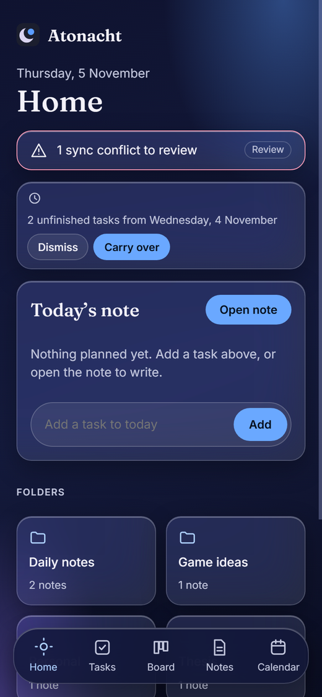
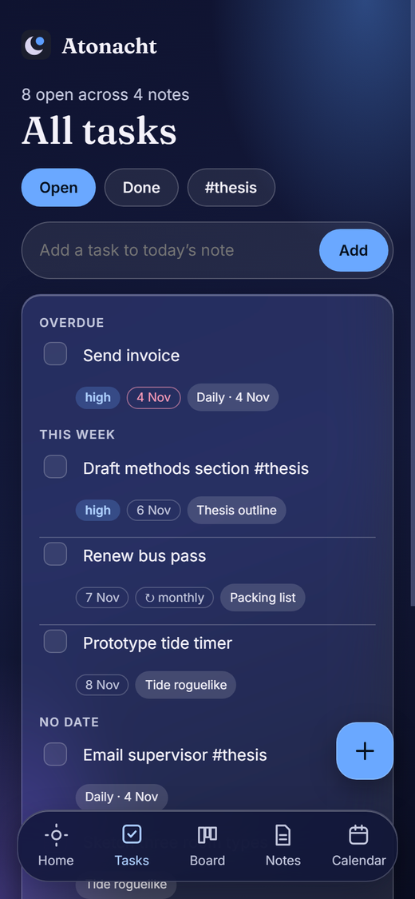
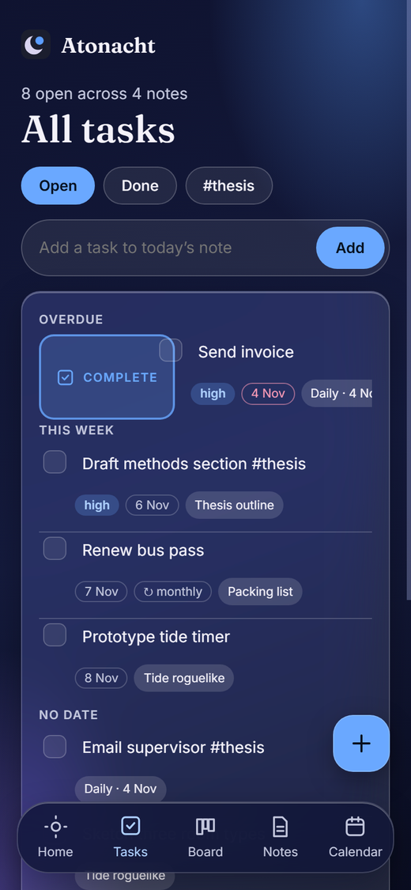
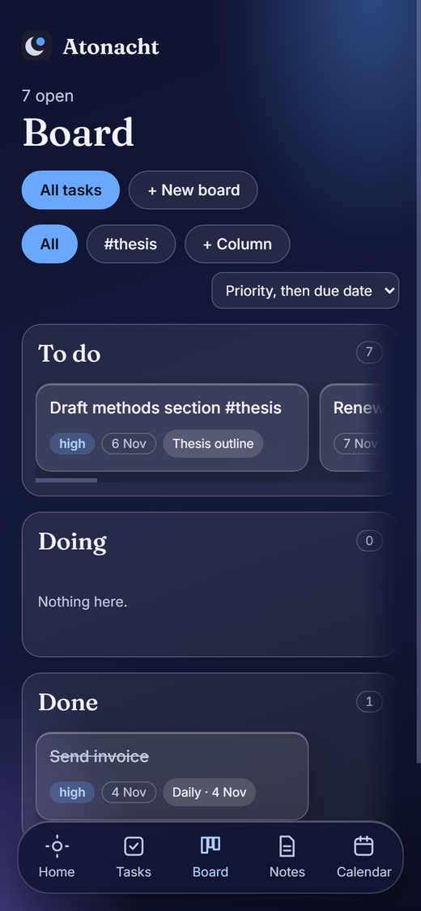
</p>
<p>
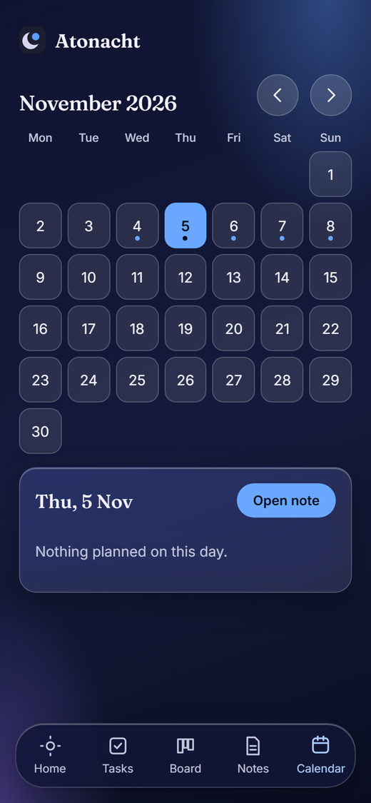
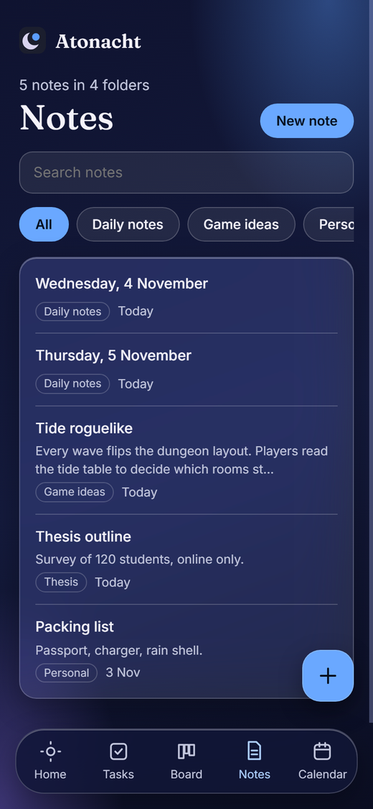
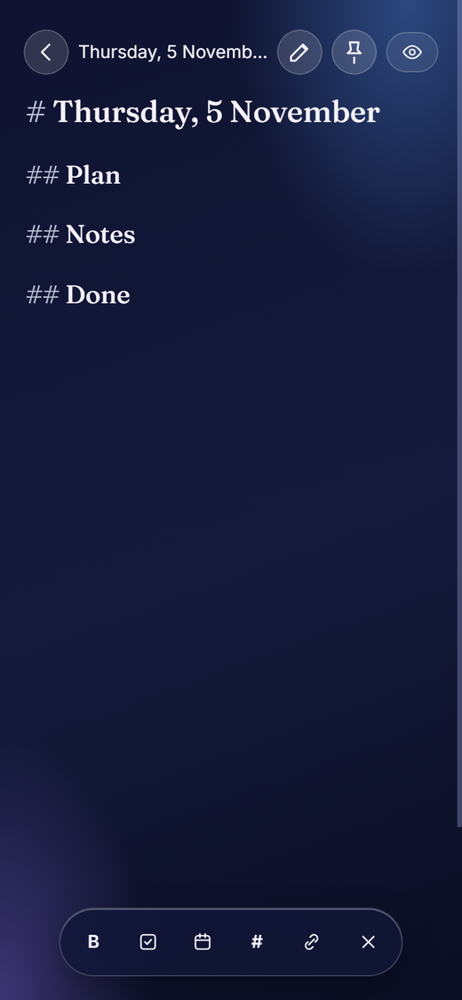

</p>

**Light theme, and the desktop layout** with its right-click menu:

<p>
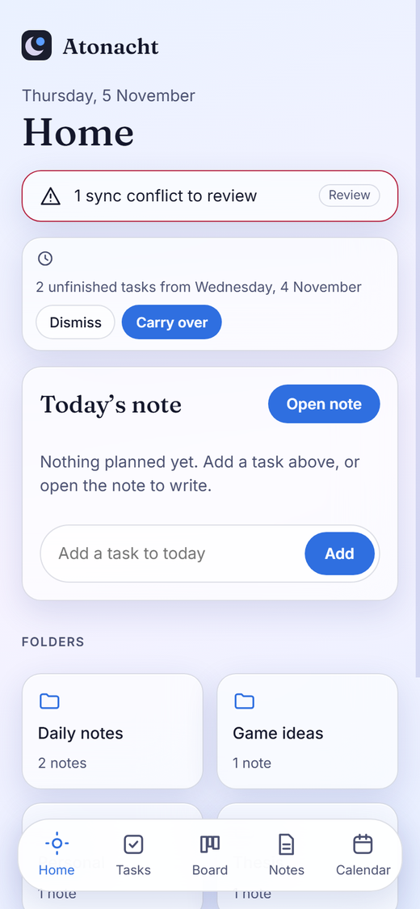
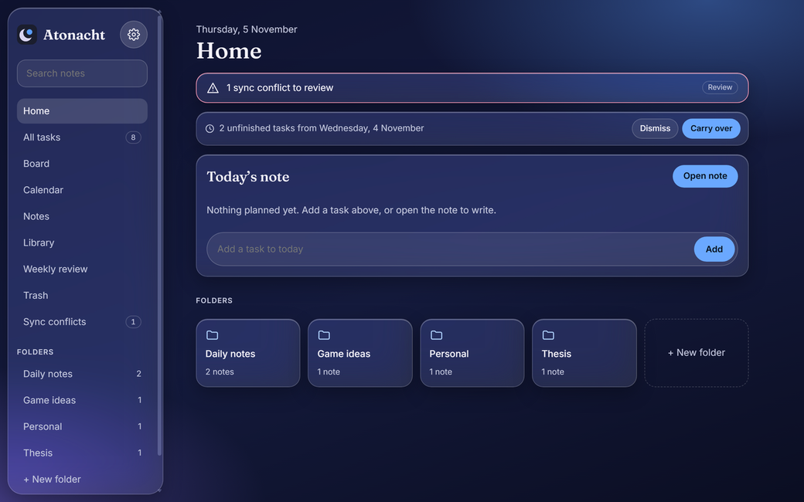
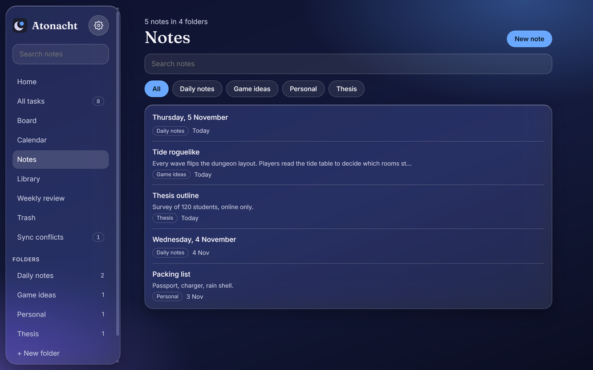
<br>
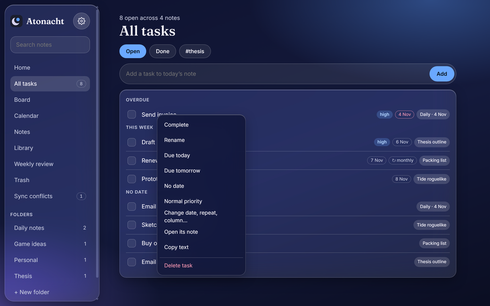
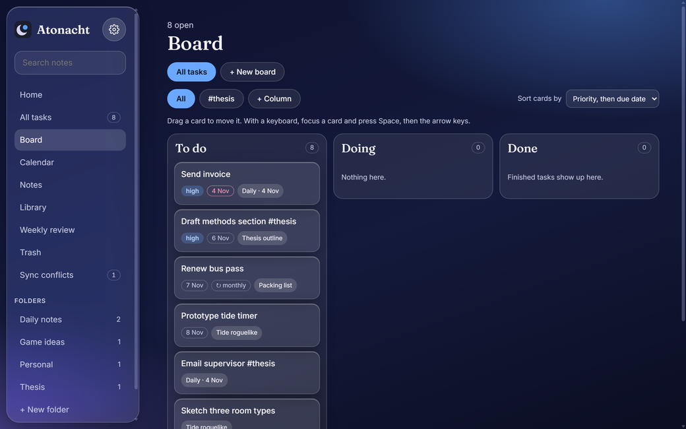
</p>

## Features

**Notes** — the raw Markdown stays on screen on every line (`##`, `- [ ]`, `@due(…)`), with headings sized and
`@due` / `!high` / `#tag` / `[[links]]` styled in place. Click a task's `- [ ]` to tick it off; Enter continues lists. The
eye button opens the preview, where **double-clicking a line edits just that line** (Enter writes it back, Shift+Enter
adds a line, Esc cancels). The preview draws the note as written — headings, checkboxes, bullets, numbered lists,
`> quotes` (nested ones too), `---` rules, `| pipe | tables |` with their `:--`/`--:` alignment, and fenced code as one
block — instead of one grey paragraph. Folders, search, pinned notes (`pinned: true` front matter, so it syncs),
rename/move, templates in `Templates/` (`{{title}}`, `{{date}}`, `{{long_date}}`), and a Trash that empties itself after
7, 30 or 90 days — the deletion time lives in the file name, so it survives syncing. Renaming or moving a note rewrites
every note that pointed at it (`[[old]]`, `[[old|alias]]` and `[[old#heading]]`), and one Undo puts the links and the
file name back.

**Attachments** — paste a picture into a note, or use the paperclip: the bytes go into `Attachments/` and a link is
written at the cursor. A photo whose long edge is over 2000 px (a 12 MP phone photo is 4032 px wide) is redrawn at
2000 px, JPEG/WebP quality 0.85, before it is written, while PNG, GIF, SVG and AVIF are stored exactly as they arrived,
so transparency survives. The preview reads them back through the folder, so it works the same on the desktop (Rust),
on Android (SAF) and in the browser demo. Pictures outside the folder are left as ordinary Markdown images.

**Links and tags** — every note shows what it links to and what points at it; a `[[link]]` to a name no note has is shown
as missing rather than dropped, and it opens whether you wrote the file name or the note's title. Ordinary Markdown
links (`[text](https://…)` and `<https://…>`) open in your browser — `http`, `https` and `mailto` only, anything else
stays literal text — and a `[[link]]` can be followed in the live editor too (Ctrl/Cmd-click, since a plain click there
has to place the cursor). Tags have their own screen with counts, and search understands `tag:`, `in:`, `due:`, `is:`
and `has:`. A result row shows the line that actually matched, with the term marked, rather than the note's opening
line.

**Tasks** live in the note text. Every checkbox in every note appears in All tasks, grouped Overdue / Today / This week /
Later / No date, and checking one writes back to its source note. Repeats: `daily`, `weekdays`, `weekly`, `weekly:thu`,
`monthly`, `monthly:29`, `yearly`, counted from the due date or the completion date. Home shows today's note with quick
add, carry-over of yesterday's leftovers, due today and pinned notes. **Tap a task to rename it in place; hold it for due
date, priority, repeat and board column.** On a phone, swipe right to complete and left to move to tomorrow or delete —
with a live panel while dragging and Undo after a delete. All tasks has a search box of its own (same `tag:` / `due:` /
`is:` grammar, plus a plain text match), and long lists — Done included — draw 100 rows at a time and end in **Show
more** rather than stopping at an arbitrary limit.

**Board** — To do, Doing, Done plus any columns you add; a card's column is stored as `@status(doing)` in its line, and a
checked task is in Done (a repeating task dropped there starts its next round in To do). Sort by priority, due date, note
order or A–Z. Project boards are separate notes in `Boards/`, in Obsidian's Kanban format (`kanban-plugin: basic`,
columns as `##`, cards as list items), so the same file opens in both apps and dragging reorders the file. Drag with
mouse, pen, touch-hold or keyboard (Space, arrows, Space, Esc). On a phone the columns stack down the page and each
column's cards scroll sideways.

**Calendar** — the tasks written in a day's note, plus everything due that day. **Weekly review** — finished tasks, then
move each open one to next week, someday or drop; saves a summary note in `Weekly reviews/`.

**Sync** — share the notes folder with Syncthing (Syncthing-Fork on Android). Atonacht reloads as files arrive, detects
`*.sync-conflict-*` copies, shows a diff, and resolves with Keep this device / Keep other / Keep both; nothing is deleted
without going to `.trash`. Settings → Sync walks through the setup in three steps and can read Syncthing's own status
(connected devices, folder progress) with an API key.

**GitHub as a second remote** — repository, branch and a fine-grained token in Settings → Sync. Sync fetches, reconciles
and commits (one commit per sync, not one per note) and runs on start and every ten minutes when GitHub is the chosen
remote; when both sides changed the same note the remote copy is kept beside yours, and the copies left by a resolved
conflict stay on the device that made them instead of being pushed to the others. A note's commits are on their own
screen, with the old text and a Restore button.

**History without a repository** — every save keeps the text it replaced, the last five versions per note, in the app's
own storage (IndexedDB; notes over 200 kB are skipped). The clock in the editor lists them under *On this device*, with
the same preview and Restore, so a bad edit, an outside editor or Android's truncate-then-write save can be undone with
nothing configured. Restoring keeps the text it replaces as a version too, so a restore is undoable; Settings →
Files & backup has a *Clear local version history* row. These versions are per device and never synced.

**Reminders** — due-date reminders at a time you choose, plus a daily-plan and weekly-review nudge. A task can name its
own time with `@at(18:30)`, and quiet hours (22:00–07:00 by default) move anything that would land inside them to the
morning instead of dropping it. On Android they are handed to the system, so they fire with the app closed; on desktop
they fire while it runs.

**On Android** — system folder picker (no "all files" permission), a Today widget and a quick-add widget, "Add to
Atonacht" in the share sheet, app lock (fingerprint, face or screen lock), hide in recents, block screenshots, full screen
with the status and navigation bars hidden, and the back gesture: it closes what is open, steps back a screen, returns to
Home, then leaves the app. Widgets cannot tick tasks off — tapping one opens the app. Updates install from inside the app:
the update screen fetches the APK for the phone's own ABI from the release, shows the download as it arrives, checks every
byte against the size GitHub reported, and then hands it to Android's installer — so the APK is installed by Atonacht
instead of being left in a browser's Downloads folder.

**Elsewhere** — Diagnostics (version, folder, last error, copy for a bug report), command palette (Ctrl/Cmd + K), ZIP
backup and restore (existing notes are never overwritten), and About with the version, the licence list, an update check
against GitHub releases that links to the release page (a computer cannot install an APK) and a pre-filled "Report a
problem" issue.

## Note format

Plain Markdown; a task is a checkbox line with optional plain-text metadata:

```
- [ ] Draft methods section @due(2026-10-30) !high #thesis [[Thesis outline]]
- [ ] Renew bus pass @due(2026-11-01) @repeat(monthly)
- [ ] Draft methods section @status(doing)
- [x] Pay rent @done(2026-10-29)
- [>] Moved to another day (written by carry-over)
- [-] Dropped in the weekly review
```

Dates in a task can also be typed the way you would say them — `Buy milk tomorrow 5pm`, `gym fri`, `pay rent on 31 dec`
— and a task with no date at all is due today. Daily notes are `Daily notes/YYYY-MM-DD.md` (folder configurable). Paths
starting with `.` (`.trash`, `.stfolder`, `.stversions`) are ignored.

## Build and run

```bash
npm install
npm test                  # 287 unit and UI tests
npm run dev               # browser demo with sample notes: no real files, no notifications
npm run tauri dev         # desktop app
npm run tauri build       # desktop installers
```

Desktop needs Rust 1.77 or newer (Tauri 2's floor) and the [Tauri prerequisites](https://v2.tauri.app/start/prerequisites/).
`npm test` runs the 287 tests, `npm run build` type-checks before it bundles; `cargo test` runs 16 tests against the
desktop file layer. CI runs all three; pushing a tag builds installers for Windows, macOS and Linux and signs one APK
per ABI.

```bash
npm run android:setup     # tauri android init, then widget, share receiver, permissions, manifest and boot theme
npm run tauri android dev
npx tauri android build --apk -t aarch64     # then: bash scripts/sign-release.sh
```

First run asks for the notes folder (default `~/Documents/Atonacht`); share that folder in Syncthing. On Android, allow
notifications when asked (and "Alarms & reminders" if they arrive late), add the widgets from the launcher, and share any
text to "Add to Atonacht". The widget list refreshes whenever the app is open.

## Performance

Measured from the production build and the test runner, not on a phone:

- 92 kB of compressed JavaScript on first load (the entry chunk: 282 kB raw) plus 9 kB of CSS. Home, All tasks and
  Notes are in it; the editor (178 kB compressed), settings, board, calendar, library, palette, trash, weekly review,
  conflicts and the ZIP backup load on first use.
- Saving a note re-parses only the note that changed, so typing in a 5,000-note folder never re-reads the folder.
- The preview renders a 14,000-line note in about 75 ms and is memoised, so typing does not re-render it; the live
  editor decorates only the lines on screen.
- Task lists and large folders draw 100 rows at a time with "Show more".
- Installers for 0.2.0 (`gh release view v0.2.0 --json assets`): 3.2 MB `.exe`, 4.2 MB `.msi`, 5.8 MB `.deb`/`.rpm`,
  10.5 MB `.dmg`, and 84 MB for the AppImage, which carries its own web engine. Android: 17 MB for `arm`, 21 MB for
  the others.
- A startup cache keeps the notes in IndexedDB so a launch shows them at once and re-reads only what changed. It never
  syncs and can be turned off or cleared in Settings → Files & backup.

## Layout

```
src/lib/        pure logic (tasks, repeats, daily notes, carry-over, conflicts, diff, markdown) and the file layers
                (tauriFs for desktop, safFs for Android's folder picker, memFs for the browser demo)
src/store.tsx   loads all notes, polls for changes, writes through the file layer
src/ui/         screens, live editor (live.ts + LiveEditor.tsx), settings (SettingsParts + one panel file per tab)
src-tauri/src/notes_fs.rs   desktop file layer (path safety, atomic saves, trash, watcher filter), unit tested
android/ scripts/           widget, share receiver, manifest, boot theme; .github/ CI and release builds
docs/improvement-evidence/  screenshots and DOM notes for each fix in ATONACHT_IMPROVEMENT_SPEC.md
```

## Known limits

- Android cannot swap a finished file into place, so a save briefly empties the note before writing it; Atonacht reads it
  back and rewrites if needed. Leave Syncthing's "Watcher delay" at 10 s or higher. The text a save replaces is kept in
  the local version history, so even that moment is recoverable from History.
- Android checks for changes every 8 seconds; only desktop has a real file watcher (and polls every 30 s as a safety net).
- "Hide content in recent apps" needs Android 13+; older versions fall back to blocking screenshots.
- Notes deleted before this version carry no deletion time; their clock starts the first time the app sees them.
- No iOS build.
- Not yet run on hardware: Android on a physical device (the folder picker with real document providers, widgets, the
  share sheet, scheduled notifications, the screenshot and recents options), the fingerprint plugin, Syncthing's status
  API against a live Syncthing, and the macOS and Linux builds. The Windows build has been launched and renders. The
  in-app update (0.3.1) is compiled for all four Android ABIs but has not yet been pressed on a phone: it is the first
  thing to try on one, since only a real install proves the FileProvider hand-off and the install permission.

## Release

- **APKs** are built one per ABI instead of one universal APK, which would carry four copies of the Rust library. Release
  builds are stripped with thin LTO (`[profile.release]` in `src-tauri/Cargo.toml`); 0.2.0's `arm64` APK is 21 MB.
- **Signing**: the release key is `Atonacht-keys/` (git-ignored, never committed). `scripts/sign-release.sh` signs an APK
  with it; CI expects `ANDROID_KEYSTORE_BASE64`, `ANDROID_KEYSTORE_PASSWORD` and `ANDROID_KEY_ALIAS=atonacht`. An APK
  signed with a different key cannot update an installed one — keep that file.
- **Licence**: Apache-2.0 (`LICENSE`). Bundled fonts are SIL OFL 1.1 (`licences/`); libraries are listed in
  `THIRD-PARTY.md`.
- **Backups**: the generated manifest sets `android:allowBackup="false"`; the notes folder is your copy, not the app's
  cache.
- **Exact alarms**: reminders use `SCHEDULE_EXACT_ALARM`, which Google Play allows only with a declared use (a reminder
  at the minute you chose). Publishing there means documenting that or accepting inexact delivery.

See `RELEASING.md` for versioning and publishing.
